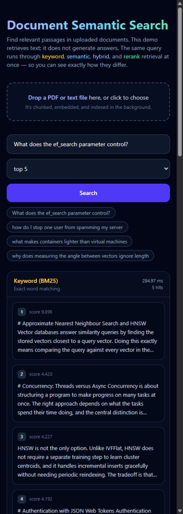
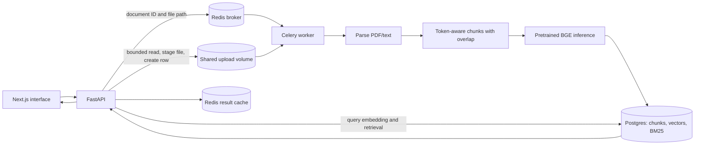

# Document Semantic Search

A local document retrieval app that compares **BM25, embeddings, Reciprocal Rank Fusion,
and cross-encoder reranking** on the same query. Upload PDF, text or Markdown and find
relevant passages. It does not generate answers, train an embedding model, or provide
multi-user document privacy.

Built with AI assistance as a student portfolio project in applied AI and backend
engineering. The engineering work is integrating pretrained inference with indexing,
asynchronous ingestion, API behavior, failure recovery and evaluation.

**Python · FastAPI · PostgreSQL/pgvector/ParadeDB · Redis · Celery · Next.js/React · Docker**



## Run locally

Install Docker Desktop with Linux containers (or Docker Engine + Compose v2). Run from
this repository. The API and frontend bind to loopback; Postgres and Redis stay internal.
The first backend build downloads CPU PyTorch and two model snapshots and can be large.

```bash
docker compose up -d --build
# Wait for the API to become healthy:
curl http://localhost:8000/health
# Only in this disposable demo database; --reset deletes its existing documents:
docker compose exec -T api python -m eval.ingest_corpus --reset
```

Open **http://localhost:3000** and choose an example, or upload your own demo file.
If those ports are occupied, set `API_PORT` and `FRONTEND_PORT` in `.env` before starting.
Interactive API docs: **http://localhost:8000/docs**. The browser uses `/api` through
Next.js, so the frontend works on a different host without embedding a localhost API URL.
For frontend development outside Docker, set `API_INTERNAL_URL=http://localhost:8000`.

```bash
curl -X POST http://localhost:8000/search -H 'Content-Type: application/json' \
  -d '{"query":"What does the ef_search parameter control?","mode":"hybrid","k":5}'
```

Stop with `docker compose down`; volumes survive. `down -v` deletes demo data.
A synthetic [upload sample](docs/demo-document.txt) and [upload screenshot](docs/images/local-upload.jpg) are included.
The maintained services use pinned ParadeDB/Redis digests and pinned model revisions.
The Python base image and transitive Python dependencies are not a complete supply-chain lock.
See [current verification](docs/verification/REPORT.md) for the tested environment and
whether each image was built or reused. A successful cached run is not a clean-build claim.

## What happens



**Upload journey:** bounded application read → document row → shared staging file →
queue submission → worker lock → `processing` → parsing → chunking → embedding →
atomic chunk replacement + `done` → staging cleanup. Submission errors return 503 and
mark the row failed. An ambiguous broker timeout retains the file because a task might
still arrive. A late delivery may finish the document; otherwise re-upload and inspect
orphan staging files before removing them. `python -m scripts.recover_ingestion <id>`
reports whether a preserved file exists; add `--requeue` only after resolving the fault. This is not a transactional outbox. A database outage spanning all retries can also leave
a status stale until the database recovers and an operator requeues the preserved file.

**Search journey:** request validation → Redis token bucket → database corpus version →
cache lookup → retrieval → ranking → response → four UI columns. Cache keys preserve
query case and include the committed corpus version. Entries from an older corpus expire
by TTL but are no longer used. The direct benchmark bypasses this HTTP/cache path.

| Mode | Retrieval and ranking | Score meaning |
|---|---|---|
| keyword | ParadeDB BM25 over chunk text | lexical relevance |
| semantic | query embedding, pgvector cosine distance | cosine similarity |
| hybrid | top 50 from each retriever, fuse ranks with RRF constant 60 | rank-fusion sum |
| rerank | union of up to 30 from each retriever, cross-encoder scoring | model relevance score |

Scores have different scales; compare rankings, not raw scores across columns.
BGE small produces 384-dimensional normalized vectors; queries receive a retrieval
instruction prefix and passages do not. The reranker reads each query/passage pair
and truncates pairs to 512 tokens. It cannot recover passages missing from its candidate union.

## Reliability and API

| Endpoint | Behavior |
|---|---|
| `POST /documents` | multipart `file`, 202 after submission; empty 400, oversized 413, staging/broker failure 503 |
| `GET /documents/{id}` | `pending`, `processing`, `done` or `failed`, chunk count and error |
| `POST /search` | `query`, mode, `k` from 1 to 50; 422 for invalid/model-overlong queries, 429 for rate limit |
| `GET /health` | Postgres and Redis readiness (503 on dependency failure) |
| `GET /metrics` | local monitoring metrics; optional Prometheus/Grafana profile |

- Celery retries exceptions twice with bounded backoff. Late acknowledgements and worker-loss
  rejection allow redelivery; the visibility timeout must exceed expected task duration.
- A session advisory lock serializes deliveries for one document across status commits.
  Completed documents skip repeated work. Chunk replacement and completion commit together.
- Failed attempts retain staging bytes until retries are exhausted; terminal failures remove
  chunks and staging bytes. A hard worker crash can delay recovery until visibility timeout.
- Chunk overlap fits *inside* the token budget. Oversized single strings split by tokenizer
  offsets, with source-text slices checked again. Invalid budgets fail explicitly. Queries include the
  prefix and special tokens in their limit check; oversized input is rejected instead of silently
  truncated by the embedding model.
- Redis AOF and its volume preserve broker state across container recreation. `everysec`
  fsync can lose recent writes on sudden host failure; backups and an outbox are future work.
- An optional `INGEST_API_KEY` protects uploads, not search or document ownership. This
  shared-corpus design is suitable for a local demo, not private multi-user deployment.

## Evaluation: useful evidence with narrow scope

The authored corpus contains 22 short CS/backend documents. The original query file has
59 authored queries. Binary relevance is inferred from marker phrases appearing in chunk
text, not independent human judgments. Markers can miss good paraphrases, label incidental
mentions, and change meaning when chunk boundaries change. This is a regression fixture,
not a production-quality relevance dataset or proof that any mode always wins.

```bash
docker compose exec -T api python -m eval.run_benchmark --k 5 --repeats 3
# prints a new timestamped directory; use that path below
docker compose exec -T api python -m eval.check_regression \
  --current eval/results/<run>/benchmark.json --max-drop 0.05
# Development probes are separate from the original report queries:
docker compose exec -T api python -m eval.run_benchmark \
  --queries eval/queries.dev.json --k 5 --repeats 1
```

Each benchmark report records hardware, package versions, model names, configuration, corpus
and query fingerprints, first-request model-loading time and warmed direct-retrieval latency.
Results never overwrite an existing benchmark JSON. Cached HTTP latency is measured
separately in the worker verification; it is not model inference latency. Percentiles from
59 queries and a few repeats have limited statistical meaning. Concurrent UI inference and
other processes can affect timing.

P@5 = relevant hits / 5 (missing positions count as zero). Recall@k = found relevant chunks /
all marked relevant chunks. MRR averages 1 / the first relevant rank; this implementation
measures it within the retrieved cutoff. nDCG rewards relevant chunks near the top using
logarithmic discounts and divides by the ideal ranking. The historical precision function
used the number of returned hits as denominator; comparisons must account for that change.

[Latest measured results and limitations](docs/verification/REPORT.md) ·
[Preserved historical README/results context](docs/history/README-20261013.md) ·
[Evaluation methodology](docs/evaluation.md)

## Checks

```bash
docker compose exec -T api pytest --strict-integration -ra
# Real worker/broker journey; adds uniquely named demo documents, run AFTER benchmarking:
docker compose exec -T api python -m scripts.verify_worker
```

The strict option fails a run with skipped tests. HTTP tests that mock `.delay` verify
request behavior only; `verify_worker` submits real messages and checks success, malformed
PDF retries, concurrent/repeated delivery and cache refresh after ingestion. CI builds the
stack, loads the corpus, runs strict tests, lint, selected type checks and an nDCG regression
check. Lint/type tools are CI-only dependencies, installed explicitly in the workflow.

## Learn and explain the project

[Worked examples and a small coding exercise](docs/learning.md) ·
[CV evidence checklist](docs/cv-evidence.md) ·
[Google Cloud deployment preparation](docs/google-cloud.md)

The backend is in `app/`, UI in `frontend/`, evaluation in `eval/`, and schema/index setup
in `scripts/init_db.py`. The historical `docs/history/AUDIT-20261013.md` records earlier sessions; current claims
come from `docs/verification/REPORT.md`.

## Limits before public use

Use only demo documents. There is no login, tenant isolation, owner-based filtering,
document deletion API, OCR for scanned PDFs, or transactional producer outbox. Multipart
spooling precedes the bounded endpoint read, so a reverse proxy must enforce a request-body
cap before accepting public uploads. PDF parsing still needs resource isolation for hostile
files. Rate limits fail open when Redis is unavailable and client-IP handling needs review
behind proxies. Health errors may reveal operational details. The shared upload volume requires
API and worker co-location or an object-storage redesign. Optional monitoring is not a security
boundary. Do not expose the current service to private documents or unrestricted public uploads.

Google Cloud deployment is prepared, but it requires an approved project, budget and exposure
policy before resources are created. No live-demo URL is claimed until deployed and verified.

MIT license. Model licenses and upstream dependency licenses remain applicable.
